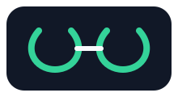

<p align="center"></p>
<p align="center"></p>
<p align="center"><a href="LICENSE"></a>   </p>
<p align="center"></p>

## 🧭 Overview
A dependency-free Node.js CLI that demonstrates the built-in EventEmitter listener lifecycle and event ordering.

## ✨ Features
- 📣 Compare regular listeners with prependListener ordering
- 🔂 See how once listeners are removed after their first event
- 🧹 Remove listeners with off and handle the special error event

## 🎬 Demo
The CLI prints a labelled event trace. No hosted demo is claimed.

## 🚀 Quick Start
```bash
npm start
```

## 🧰 Tech Stack
- 🧩 Node.js built-in events module
- 🔒 Local execution with no network access
- 📦 No third-party dependencies

## 🗂️ Folder Structure
```text
node-event-emitter-lab/
├── assets/mark.svg
├── src/{demo.js,main.js}
├── test/demo.test.js
├── package.json
├── .gitignore
├── LICENSE
└── README.md
```

## 🛣️ Roadmap
- [ ] Add async listener examples
- [ ] Add a configurable listener trace

## 🤝 Contributing
Issues and pull requests are welcome. Keep output deterministic and include a focused test for new behavior.

## 📄 License
Released under the [MIT License](LICENSE).

<p align="center"></p>